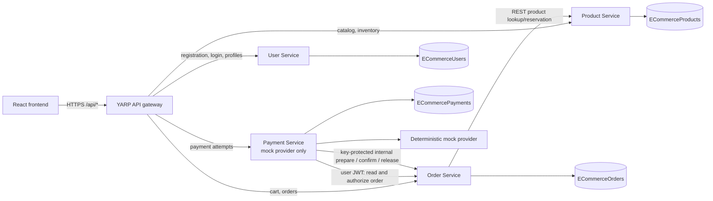

# E-Commerce Service Architecture

## Service and data boundaries

Services own their schemas. Payment Service never reads or writes the Order database directly. The gateway authenticates customer routes; each API also validates the JWT. Only Payment Service can call Order Service's `/internal/payments/*` operations with a separate 32-byte-or-longer service key.

## Mock checkout sequence

1. Order Service places an order in `Pending`, snapshots its items and amount, reserves inventory through Product Service, and clears the cart.
2. The browser sends the order ID and an idempotency key to `POST /api/payments`. Payment Service forwards the user's JWT to `GET /api/orders/{id}` and verifies the returned owner, status, and amount.
3. Payment Service persists a `Pending` payment attempt, then calls the key-protected Order Service prepare operation. The order becomes `PaymentProcessing`, preventing cancellation while the sandbox attempt is in progress.
4. The mock provider returns either a simulated decline or a deterministic transaction ID. It accepts no card number, CVV, or banking details.
5. On decline, Payment Service persists `Failed` and asks Order Service to release the payment-processing reservation, restoring the order to `Pending`. The inventory remains reserved while the pending order can be retried; canceling the pending order releases its stock through Product Service. On verified success, Payment Service persists `Successful`, then asks Order Service to record the same transaction and change the order to `Confirmed`.
6. If the order callback is temporarily unavailable after success, the payment stays recorded as successful but `OrderConfirmed` remains false. Repeating the same idempotency key retries the callback without charging a second time. Order confirmation is itself idempotent.

There is no cross-database transaction. The mock provider is deterministic and idempotent by order and amount. A production payment integration must replace it with a real provider's idempotency protocol and signed/webhook verification, add durable reconciliation for stuck `PaymentProcessing`/unconfirmed payments, and must not collect payment credentials in this demo.

## API routes

| Route | Authorization | Purpose |
|---|---|---|
| `POST /api/payments` | Customer JWT | Start/replay a mock payment by order ID and idempotency key. `mock-success` and `mock-decline` are the only provider modes. |
| `GET /api/payments/orders/{orderId}` | Customer JWT | Return the requesting customer's most recent payment attempt for that order. |
| `GET /api/orders/{id}` | Customer JWT | Payment Service reads order owner, amount, and status using the customer's bearer token. |
| `POST /internal/payments/prepare` | Payment service key | Reserve a pending order for one idempotent payment attempt. |
| `POST /internal/payments/confirm` | Payment service key | Record provider transaction ID and mark the order `Confirmed` after provider success. |
| `POST /internal/payments/release` | Payment service key | Return the order from `PaymentProcessing` to `Pending` after a simulated decline; its stock stays reserved until retry or cancellation. |

Development Swagger for Payment Service is available at `/swagger` when running in the Development environment. The service health route is `/health`; it is process health only and does not prove that SQL schema, network calls, or the provider workflow are healthy.
