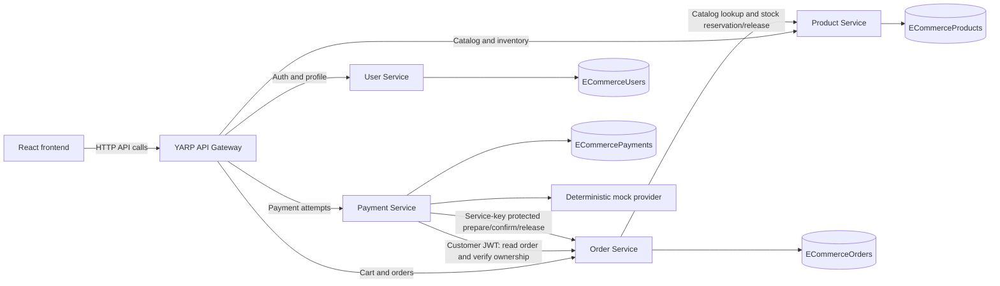

# Microservices architecture

## Overview

The React client communicates through YARP. Each backend service owns its schema and database and exposes HTTP APIs; no service reads another service's database. Service-to-service communication is REST. The original monolithic `ECommerce.API` remains available for legacy/demo use and is not included in the microservices Compose stack.

## Service responsibilities and ownership

| Service | Owns | Important interactions |
|---|---|---|
| Product Service | Product catalog, categories, inventory and reservation records; `ECommerceProducts` | Serves catalog/search APIs and accepts Order Service inventory reserve/release requests. |
| User Service | Registration, password hashes, profiles, roles and JWT issuance; `ECommerceUsers` | Issues tokens validated by the Gateway and other APIs. Public registration cannot self-assign privileged roles. |
| Order Service | Customer carts, order snapshots, lifecycle and payment coordination state; `ECommerceOrders` | Reads product data and reserves/releases stock through Product Service. Exposes customer order APIs and narrowly scoped internal payment callbacks. |
| Payment Service | Payment attempts, idempotency keys, provider result and transaction IDs; `ECommercePayments` | Verifies the customer/order through Order Service, runs only the mock provider, and calls protected Order Service prepare/confirm/release operations. |
| Gateway | Routing and edge authentication/authorization; no business database | Routes catalog/inventory to Product, auth/profile to User, cart/orders to Order and payments to Payment. |

Database connection strings are independently configured for each service. Sharing SQL Server as an infrastructure host does not share database ownership. Do not configure one service with another service's database credentials.

## Authentication and authorization

1. The frontend submits registration or login through the Gateway to User Service.
2. User Service issues a JWT signed using the configured shared key, issuer and audience.
3. The Gateway validates JWTs and route policies. Each downstream API also validates the JWT rather than trusting the Gateway alone.
4. Customer endpoints derive identity from token claims. Administrative write routes require the appropriate role.
5. Payment Service forwards the customer's bearer token when requesting the order snapshot. Internal payment callbacks use a separate service key; they are not public Gateway routes.

Production keys and database credentials belong in a managed secret store or protected deployment secrets, not in source files or container images.

## Order and payment flow

1. Order Service snapshots the cart and amount, reserves stock through Product Service, creates a pending order and clears the cart after successful order creation.
2. The frontend submits the order ID and idempotency key to `POST /api/payments`.
3. Payment Service verifies order ownership and amount with the customer token, persists a payment attempt, and asks Order Service to move the order into `PaymentProcessing`.
4. The mock provider deterministically returns success or decline. It accepts no card or bank details.
5. A decline is persisted as failed and releases the payment-processing reservation, returning the order to `Pending`. Inventory stays reserved while the order can be retried; canceling the pending order releases stock through Product Service. Success is persisted before Order Service confirms the order and records the transaction ID.
6. Replays with the same idempotency key return the existing attempt and can retry a failed confirmation callback without simulating a second charge.

There is no distributed database transaction. A production provider requires its idempotency and webhook-signature protocols, durable reconciliation for incomplete callbacks, and operational monitoring.

## Gateway route ownership

| Gateway route family | Destination | Access |
|---|---|---|
| `/api/auth/**` | User Service | Anonymous registration/login |
| `/api/users/**` | User Service | Authenticated user |
| `GET /api/products/**`, `GET /api/inventory/**` | Product Service | Catalog reads |
| Product/inventory writes | Product Service | Admin policy |
| `/api/cart/**`, `/api/orders/**` | Order Service | Authenticated user |
| `/api/payments/**` | Payment Service | Authenticated user |

The route definitions live in `ECommerce.Gateway/appsettings.json`; service destinations are overridden by environment configuration in Compose and Kubernetes. Internal `/internal/payments/*` endpoints are not Gateway routes.

## Local and deployment configuration

Podman Compose uses service DNS names on its private network and exposes only the Gateway and frontend to the host (plus SQL Server when the optional `local-sql` profile is enabled). Kubernetes uses ClusterIP Services for backend workloads and a Gateway/frontend Ingress. See [Podman setup](./PODMAN.md) and [Kubernetes deployment guide](./KUBERNETES-DEPLOYMENT-GUIDE.md).
